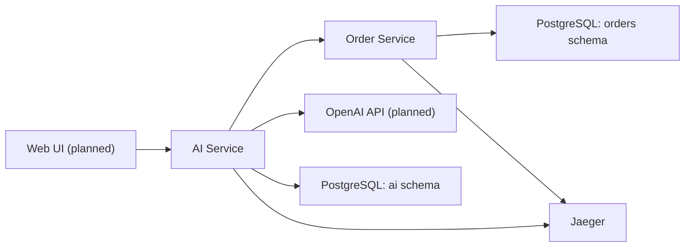

# Enterprise AI Assistant

A demonstration enterprise AI assistant built with Java, Spring Boot
and Spring AI.

The project demonstrates how an LLM can interact with enterprise
business services through controlled tool calling, retrieve knowledge
from uploaded documents, and propose business actions that require
explicit human approval.

## Project status

**Foundation implemented. Business functionality is under development.**

The current implementation provides:

- Maven multi-module project with centrally managed dependencies.
- Two independently deployable Spring Boot services.
- PostgreSQL with pgvector and isolated database schemas.
- JDBC and Flyway configuration.
- Actuator health endpoints.
- OpenTelemetry tracing with Jaeger.
- Docker Compose infrastructure.
- Frozen REST and SSE API contracts v0.2.0.
- Automated application smoke tests.

Planned business capabilities:

- Conversational AI with Spring AI.
- Read-only tool calling against Order Service.
- Live document ingestion and retrieval-augmented generation (RAG).
- Persistent conversation history.
- Human-in-the-loop business action approval.
- React and TypeScript frontend.
- End-to-end distributed tracing of AI operations.

## Architecture

The system consists of two backend services and a planned frontend.



Both database schemas belong to the same PostgreSQL instance,
but use separate runtime credentials and ownership boundaries.

AI Service must access order data through the Order Service HTTP API,
never through direct SQL access to the orders schema.

See [Architecture](docs/ARCHITECTURE.md) for details.

## Technology stack

| Technology | Version / purpose |
|---|---|
| Java | 21 LTS |
| Maven | 3.10.0 via Maven Wrapper |
| Spring Boot | 4.1.2 |
| Spring AI | 2.0.2, BOM configured |
| Spring Cloud | 2025.1.4, BOM configured |
| Spring Web MVC | HTTP API and future SSE streaming |
| Spring JDBC | Database access |
| Flyway | Database migrations |
| PostgreSQL | 16.15 |
| pgvector | 0.8.7 |
| OpenTelemetry | Distributed tracing |
| Jaeger | 2.23.0 |
| Docker Compose | Local development infrastructure |
| React / TypeScript | Planned frontend |

Spring AI and Spring Cloud OpenFeign will be integrated in
subsequent development stages.

## Repository structure

```text
.
├── pom.xml
├── mvnw
├── mvnw.cmd
├── .mvn/
├── ai-service/
│   ├── Dockerfile
│   ├── pom.xml
│   └── src/
├── order-service/
│   ├── Dockerfile
│   ├── pom.xml
│   └── src/
├── infra/
│   └── postgres/
│       └── init/
├── contracts/
│   ├── ai-service.openapi.yaml
│   ├── order-service.openapi.yaml
│   └── chat-events.md
├── docs/
│   ├── ARCHITECTURE.md
│   └── CONTRACTS.md
├── compose.yaml
├── .env.example
└── README.md
```

## Prerequisites

For Docker-based development:

- Git.
- Docker Engine or Docker Desktop.
- Docker Compose v2 with support for `up --wait`.

For local Java development:

- Java 21 JDK.
- Bash or another supported Maven Wrapper environment.
- An IDE such as IntelliJ IDEA, optionally.

A separate Maven installation is not required.

The Foundation does not require an OpenAI API key.

## Quick start

Clone the repository:

```bash
git clone https://github.com/Kamatari-rin/ai-assistant.git
cd ai-assistant
```

Create the local environment file:

```bash
cp .env.example .env
```

Open `.env` and provide non-empty local development passwords for:

```text
POSTGRES_PASSWORD
AI_DB_PASSWORD
ORDER_DB_PASSWORD
```

Use distinct passwords for the database administrator and both
application roles.

The default database and role names can remain unchanged.

Do not commit `.env` or real credentials.

Validate the Compose configuration:

```bash
docker compose config --quiet
```

Build and start the environment:

```bash
docker compose up -d --build --wait
```

Inspect service status:

```bash
docker compose ps
```

## Local endpoints

All published ports bind to localhost.

| Component | Address |
|---|---|
| AI Service | http://127.0.0.1:8080 |
| AI Service health | http://127.0.0.1:8080/actuator/health |
| Order Service | http://127.0.0.1:8081 |
| Order Service health | http://127.0.0.1:8081/actuator/health |
| Jaeger UI | http://127.0.0.1:16686 |
| OTLP HTTP traces | http://127.0.0.1:4318/v1/traces |
| PostgreSQL | 127.0.0.1:5432 |

Verify both applications:

```bash
curl -fsS http://127.0.0.1:8080/actuator/health
echo

curl -fsS http://127.0.0.1:8081/actuator/health
echo
```

Both responses should contain:

```json
{
  "status": "UP"
}
```

Additional health group fields may be present.

Business API endpoints described in the contracts are not implemented
in the Foundation.

## Build and test

With Java 21 configured:

```bash
java -version
./mvnw -version
./mvnw clean verify
```

On Windows PowerShell:

```powershell
.\mvnw.cmd clean verify
```

The Maven reactor builds both backend modules and executes their tests.

The existing smoke tests use the `test` profile and do not require
a running PostgreSQL instance.

Build the container images:

```bash
docker compose build --pull
```

Run a fresh container build without reusing build cache:

```bash
docker compose build --pull --no-cache
```

Both Dockerfiles execute Maven verification before creating the
runtime image.

PostgreSQL, Jaeger and Java base images are pinned by tag and digest.
Base image pinning improves reproducibility but does not guarantee
bit-for-bit identical application images.

## Database initialization

The PostgreSQL container initializes:

- Database: `ai_assistant`.
- AI schema: `ai`.
- Order schema: `orders`.
- AI runtime role: `ai_app`.
- Order runtime role: `orders_app`.
- pgvector extension in the `public` schema.

The bootstrap script runs when the PostgreSQL data directory
is initialized.

Each service runs its own Flyway migrations and maintains a separate
schema history table.

Foundation migrations verify schema ownership and isolation
assumptions. Business tables and vector-store tables will be added
in subsequent stages.

Changing database passwords in `.env` does not automatically modify
existing PostgreSQL roles in an initialized database volume.

## Observability

Both services export OpenTelemetry traces directly to Jaeger
using OTLP over HTTP.

Generate inbound HTTP requests:

```bash
curl -fsS http://127.0.0.1:8080/actuator/health
curl -fsS http://127.0.0.1:8081/actuator/health
```

Open:

http://127.0.0.1:16686

Select `ai-service` or `order-service` to inspect available traces.

Jaeger uses in-memory trace storage in the current local environment.
Trace data is not retained across Jaeger container replacement.

Full AI, tool calling, Feign, retrieval and business-operation traces
will be introduced with the corresponding functionality.

## API contracts

The public API contracts are frozen for the MVP at version 0.2.0.

- [AI Service OpenAPI](contracts/ai-service.openapi.yaml)
- [Order Service OpenAPI](contracts/order-service.openapi.yaml)
- [Chat SSE protocol](contracts/chat-events.md)
- [API overview](docs/CONTRACTS.md)

The contracts describe the target API and are authoritative for
future backend and frontend implementations.

## Stop the environment

```bash
docker compose down
```

The PostgreSQL named volume is preserved.

Do not use `docker compose down -v` unless you intentionally want
to delete the local database and its contents.

## Security and scope

This project is a local educational demonstration using synthetic data.

It is not intended for production deployment.

- No end-user authentication is implemented.
- All host ports are bound to localhost.
- Runtime database credentials are isolated by service.
- Real customer data and production credentials must not be used.
- Future LLM tools will use an explicit read-only allowlist.
- Business mutations will require explicit user confirmation
  and backend validation.

Production use would require authentication, authorization,
secret management, audit controls, deployment hardening
and additional security review.
