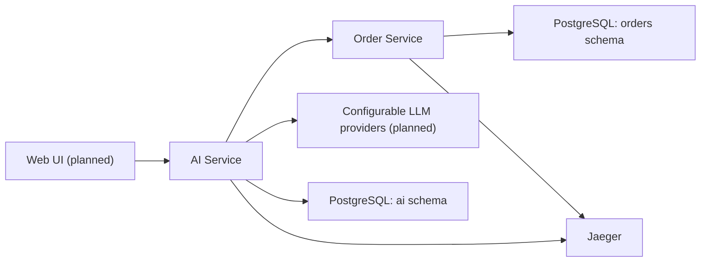

# Enterprise AI Assistant

A demonstration enterprise AI assistant built with Java, Spring Boot
and Spring AI.

The project demonstrates how an LLM can interact with enterprise
business services through controlled tool calling, retrieve knowledge
from uploaded documents, and propose business actions that require
explicit human approval.


## Project status

**Foundation and Order Service implemented. AI functionality is under development.**

The current implementation provides:

- Maven multi-module project with centrally managed dependencies.
- Two independently deployable Spring Boot services.
- Spring WebFlux and Reactor Netty for AI Service.
- Spring MVC for Order Service.
- PostgreSQL with pgvector and isolated database schemas.
- JDBC and service-owned Flyway migrations.
- Synthetic orders and order event history.
- Order lookup and chronological event retrieval REST APIs.
- Transactional escalation creation with independent business validation.
- Persistent, globally scoped escalation idempotency.
- Concurrent request protection using PostgreSQL row locks and unique constraints.
- Actuator health endpoints.
- OpenTelemetry tracing with Jaeger.
- Docker Compose infrastructure.
- Frozen AI REST/SSE contracts v0.3.0 and Order REST contract v0.2.0.
- Automated unit, WebFlux, MVC and PostgreSQL integration tests.

Planned business capabilities:

- Conversational AI with Spring AI.
- Read-only tool calling against Order Service.
- Live document ingestion and retrieval-augmented generation (RAG).
- Persistent conversation history.
- Human-in-the-loop business action approval through AI Service.
- React and TypeScript frontend.
- End-to-end distributed tracing of AI operations.

## Architecture

The system consists of two backend services and a planned frontend.



Both database schemas belong to the same PostgreSQL instance,
but use separate runtime credentials and ownership boundaries.

AI Service must access order data through the Order Service HTTP API,
never through direct SQL access to the orders schema.

See [Architecture](docs/ARCHITECTURE.md) for details.

## Technology stack

| Technology | Version / purpose |
|---|---|
| Java | 21 LTS |
| Maven | 3.10.0 via Maven Wrapper |
| Spring Boot | 4.1.2 |
| Spring AI | 2.0.2, BOM configured |
| Spring Cloud | 2025.1.4, BOM configured |
| Spring WebFlux / Reactor Netty | AI Service HTTP runtime and future SSE streaming |
| Spring Web MVC | Order Service REST API |
| Spring JDBC | Database access |
| Flyway | Database migrations |
| PostgreSQL | 16.15 |
| pgvector | 0.8.7 |
| OpenTelemetry | Distributed tracing |
| Jaeger | 2.23.0 |
| Docker Compose | Local development infrastructure |
| React / TypeScript | Planned frontend |

Spring AI and Spring Cloud OpenFeign will be integrated in
subsequent development stages.

## Repository structure

```text
.
├── pom.xml
├── mvnw
├── mvnw.cmd
├── .mvn/
├── ai-service/
│   ├── Dockerfile
│   ├── pom.xml
│   └── src/
├── order-service/
│   ├── Dockerfile
│   ├── pom.xml
│   └── src/
├── infra/
│   └── postgres/
│       └── init/
├── contracts/
│   ├── ai-service.openapi.yaml
│   ├── order-service.openapi.yaml
│   └── chat-events.md
├── docs/
│   ├── ARCHITECTURE.md
│   └── CONTRACTS.md
├── compose.yaml
├── .env.example
└── README.md
```

## Prerequisites

For Docker-based development:

- Git.
- Docker Engine or Docker Desktop.
- Docker Compose v2 with support for `up --wait`.

For local Java development:

- Java 21 JDK.
- Bash or another supported Maven Wrapper environment.
- An IDE such as IntelliJ IDEA, optionally.

A separate Maven installation is not required.

The current Foundation and Order Service implementation
does not require an LLM provider API key.

## Quick start

Clone the repository:

```bash
git clone https://github.com/Kamatari-rin/ai-assistant.git
cd ai-assistant
```

Create the local environment file:

```bash
cp .env.example .env
```

Open `.env` and provide non-empty local development passwords for:

```text
POSTGRES_PASSWORD
AI_DB_PASSWORD
ORDER_DB_PASSWORD
```

Use distinct passwords for the database administrator and both
application roles.

The default database and role names can remain unchanged.

Do not commit `.env` or real credentials.

Validate the Compose configuration:

```bash
docker compose config --quiet
```

Build and start the environment:

```bash
docker compose up -d --build --wait
```

Inspect service status:

```bash
docker compose ps
```

## Local endpoints

All published ports bind to localhost.

| Component | Address |
|---|---|
| AI Service | http://127.0.0.1:8080 |
| AI Service health | http://127.0.0.1:8080/actuator/health |
| Order Service | http://127.0.0.1:8081 |
| Order Service health | http://127.0.0.1:8081/actuator/health |
| Jaeger UI | http://127.0.0.1:16686 |
| OTLP HTTP traces | http://127.0.0.1:4318/v1/traces |
| PostgreSQL | 127.0.0.1:5432 |

Verify both applications:

```bash
curl -fsS http://127.0.0.1:8080/actuator/health
echo

curl -fsS http://127.0.0.1:8081/actuator/health
echo
```

Both responses should contain:

```json
{
  "status": "UP"
}
```

Additional health group fields may be present.


## Order Service demo API

Order Service implements all three endpoints defined in
the frozen Order Service OpenAPI contract.

| Method | Endpoint | Purpose |
|---|---|---|
| GET | /api/v1/orders/{displayNumber} | Retrieve an order |
| GET | /api/v1/orders/{displayNumber}/events | Retrieve order events |
| POST | /api/v1/orders/{displayNumber}/escalations | Create an escalation |

### Synthetic demo data

Flyway initializes the following synthetic orders:

| Order number | Status | Delay reason | Events |
|---|---|---|---|
| 12345 | DELAYED | OUT_OF_STOCK | 3 |
| 12346 | DELAYED | OUT_OF_STOCK | 2 |
| 12347 | DELAYED | OUT_OF_STOCK | 0 |

Order numbers are exact strings, not numeric identifiers.

A fresh database contains no escalation records.

### Retrieve an order

```bash
curl -fsS http://127.0.0.1:8081/api/v1/orders/12345
echo
```

Example response:

```json
{
  "id": "09b98c5b-37a5-4fa3-97c7-a016d7517760",
  "displayNumber": "12345",
  "status": "DELAYED",
  "delayReason": "OUT_OF_STOCK",
  "updatedAt": "2026-11-11T10:30:00Z"
}
```

### Retrieve order events

```bash
curl -fsS http://127.0.0.1:8081/api/v1/orders/12345/events
echo

curl -fsS http://127.0.0.1:8081/api/v1/orders/12347/events
echo
```

Events are returned in chronological order, with event ID
as a deterministic tie-breaker.

An existing order without events returns HTTP 200:

```json
{
  "items": []
}
```

An unknown order returns HTTP 404 with `ORDER_NOT_FOUND`.

### Create and replay an escalation

The following commands directly invoke the business mutation API.
They are intended for local development and API testing only.

They do not represent the planned AI Service human approval flow.

Use a new UUID for each independent logical escalation operation.
Reuse the same UUID when retrying that operation.

```bash
KEY="f90fd699-154c-4ddb-9b9a-316ea31b2b07"

curl -i -sS \
  -X POST \
  http://127.0.0.1:8081/api/v1/orders/12345/escalations \
  -H "Content-Type: application/json" \
  -H "Accept: application/json, application/problem+json" \
  -H "Idempotency-Key: $KEY" \
  --data '{"reason":"OUT_OF_STOCK","priority":"HIGH"}'
```

The first successful execution with an unused key returns HTTP 201.

Example response:

```json
{
  "escalationId": "5a3bb692-d257-491c-9212-d49ea1518ed1",
  "orderNumber": "12345",
  "status": "CREATED"
}
```

The escalation ID is generated by the service.

Repeating the same command returns HTTP 200 with the same
persisted response. If the example key was used previously,
the first invocation may already be a replay.

Reusing the same key for order `12346` returns HTTP 409:

```bash
curl -i -sS \
  -X POST \
  http://127.0.0.1:8081/api/v1/orders/12346/escalations \
  -H "Content-Type: application/json" \
  -H "Accept: application/json, application/problem+json" \
  -H "Idempotency-Key: $KEY" \
  --data '{"reason":"OUT_OF_STOCK","priority":"HIGH"}'
```

The error code is `IDEMPOTENCY_CONFLICT`.

Escalation records are stored in PostgreSQL. Restarting Order
Service does not reset previously used idempotency keys.

Creating an escalation does not change the order status,
order timestamps or order event history.

See the [Order Service OpenAPI](contracts/order-service.openapi.yaml)
for the authoritative request and response schemas.

## Build and test

With Java 21 configured:

```bash
java -version
./mvnw -version
./mvnw clean verify
```

On Windows PowerShell:

```powershell
.\mvnw.cmd clean verify
```

The Maven reactor builds both backend modules and executes their tests.


The standard Maven verification runs unit, application, WebFlux and MVC tests.

Database-independent Spring tests use the `test` profile and
do not require a running PostgreSQL instance.

### PostgreSQL integration tests

Order Service also provides an opt-in integration test suite
using Testcontainers and the pinned PostgreSQL image.

Docker must be available when running these tests.

```bash
./mvnw -B -ntp -pl order-service -am -Pintegration clean verify
```

On Windows PowerShell:

```powershell
.\mvnw.cmd -B -ntp -pl order-service -am -Pintegration clean verify
```

Integration tests verify:

- PostgreSQL initialization and schema ownership.
- Fresh Flyway migrations and upgrades from V1.
- Database constraints and deterministic demo data.
- JDBC mapping and chronological event ordering.
- Transactional escalation creation and rollback.
- Global idempotency and persisted replay.
- Concurrent row locking and unique-key conflict resolution.

The integration suite uses isolated temporary PostgreSQL
containers and does not modify the local development database.

Maven Surefire runs the standard tests.
Maven Failsafe runs the `*IT` integration tests when the
`integration` Maven profile is enabled.

The standard Maven build and Dockerfile builds do not execute
the Testcontainers integration suite.

Build the container images:

```bash
docker compose build --pull
```

Run a fresh container build without reusing build cache:

```bash
docker compose build --pull --no-cache
```

Both Dockerfiles execute Maven verification before creating the
runtime image.

PostgreSQL, Jaeger and Java base images are pinned by tag and digest.
Base image pinning improves reproducibility but does not guarantee
bit-for-bit identical application images.

## Database initialization

The PostgreSQL container initializes:

- Database: `ai_assistant`.
- AI schema: `ai`.
- Order schema: `orders`.
- AI runtime role: `ai_app`.
- Order runtime role: `orders_app`.
- pgvector extension in the `public` schema.

The bootstrap script runs when the PostgreSQL data directory
is initialized.

Each service runs its own Flyway migrations and maintains a separate
schema history table.

Foundation migrations verify schema ownership and isolation
assumptions.

Order Service currently manages three migrations:

| Version | Purpose |
|---|---|
| V1 | Verify order schema ownership |
| V2 | Create orders, order_events and escalations tables |
| V3 | Insert deterministic synthetic orders and events |

Applied migrations are immutable.

Flyway validates the migration history on startup and applies
pending migrations.

An existing Foundation database can be upgraded to the current
Order Service schema without deleting its named volume.

AI-owned conversation, document, vector-store and action proposal
tables will be introduced in subsequent implementation stages.

Changing database passwords in `.env` does not automatically modify
existing PostgreSQL roles in an initialized database volume.

## Observability

Both services export OpenTelemetry traces directly to Jaeger
using OTLP over HTTP.

Generate inbound HTTP requests:

```bash
curl -fsS http://127.0.0.1:8080/actuator/health
curl -fsS http://127.0.0.1:8081/actuator/health
```

Open:

http://127.0.0.1:16686

Select `ai-service` or `order-service` to inspect available traces.

Jaeger uses in-memory trace storage in the current local environment.
Trace data is not retained across Jaeger container replacement.

Full AI, tool calling, Feign, retrieval and business-operation traces
will be introduced with the corresponding functionality.

## API contracts

The AI Service REST and SSE contracts are frozen at version 0.3.0.
The Order Service REST contract remains frozen at version 0.2.0.

- [AI Service OpenAPI](contracts/ai-service.openapi.yaml)
- [Order Service OpenAPI](contracts/order-service.openapi.yaml)
- [Chat SSE protocol](contracts/chat-events.md)
- [API overview](docs/CONTRACTS.md)

The contracts are authoritative for backend and frontend
implementations.

Order Service implements its frozen REST contract.
AI Service business APIs and the chat SSE protocol remain
target specifications for subsequent implementation stages.

## Stop the environment

```bash
docker compose down
```

The PostgreSQL named volume is preserved.

Do not use `docker compose down -v` unless you intentionally want
to delete the local database and its contents.

## Security and scope

This project is a local educational demonstration using synthetic data.

It is not intended for production deployment.

- No end-user authentication is implemented.
- All host ports are bound to localhost.
- Runtime database credentials are isolated by service.
- Real customer data and production credentials must not be used.
- Future LLM tools will use an explicit read-only allowlist.
- Order Service independently validates escalation requests
  and business eligibility.
- Direct Order Service mutation calls are available for local
  development and API testing.
- The planned AI Service approval flow will require explicit
  user confirmation before invoking business mutations.

Production use would require authentication, authorization,
secret management, audit controls, deployment hardening
and additional security review.
