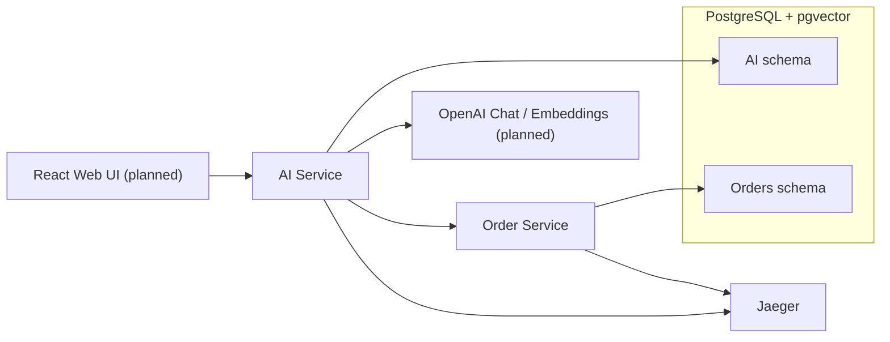
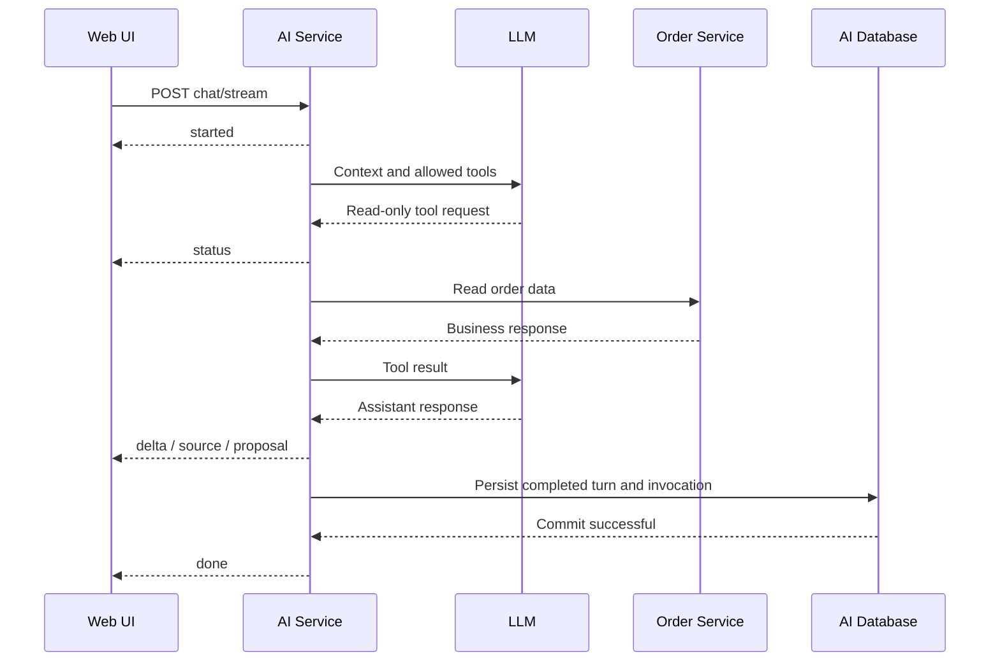
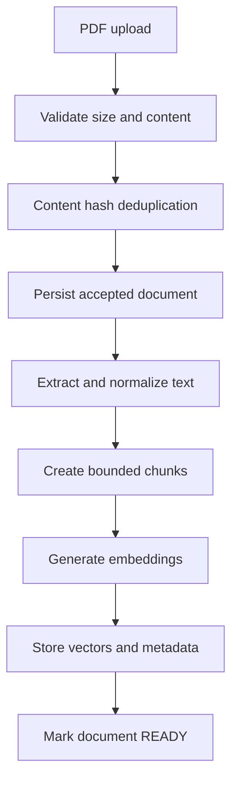
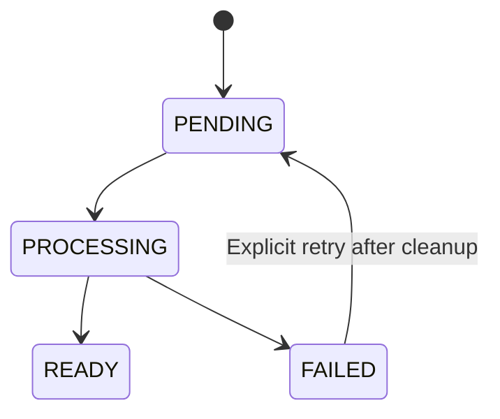
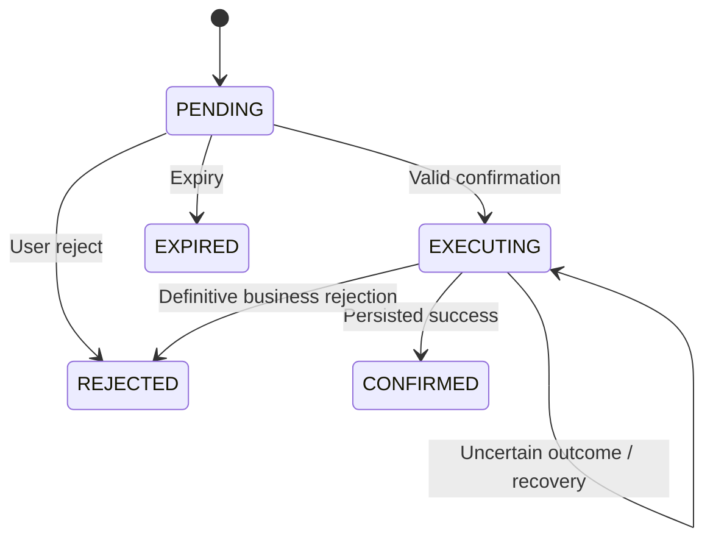

# System Architecture

## Overview

Enterprise AI Assistant is a demonstration system that combines
conversational AI, controlled tool calling, document retrieval
and explicit approval of business actions.

The architecture separates AI orchestration from business
data ownership and business mutation execution.

The Foundation currently implements application startup,
database infrastructure, migrations, health endpoints
and HTTP tracing.

Business capabilities described below represent the target
MVP architecture unless explicitly marked as implemented.

## System context



## Components

### AI Service

Implemented Foundation:

- Spring Boot application.
- Spring MVC infrastructure.
- JDBC datasource.
- AI-owned Flyway migrations.
- Health endpoint.
- OpenTelemetry trace exporter.

Planned responsibilities:

- Chat orchestration.
- LLM integration through Spring AI.
- Tool registration and execution limits.
- Conversation persistence.
- Document ingestion and retrieval.
- Action proposal validation.
- Explicit action approval API.
- SSE response streaming.

AI Service does not own order data and must not access the
orders database schema directly.

### Order Service

Implemented Foundation:

- Independent Spring Boot application.
- Spring MVC infrastructure.
- JDBC datasource.
- Order-owned Flyway migrations.
- Health endpoint.
- OpenTelemetry trace exporter.

Planned responsibilities:

- Order lookup.
- Order event retrieval.
- Escalation creation.
- Business rule validation.
- Idempotent mutation execution.

Order Service is authoritative for order data and escalation
business rules.

### Web UI

Planned React and TypeScript application.

Responsibilities:

- Submit chat requests.
- Parse streamed SSE events.
- Display progress, assistant responses and citations.
- Upload documents and poll ingestion status.
- Display action proposals.
- Request explicit user confirmation.
- Display persisted action results.
- Link to Jaeger traces.

The browser communicates with AI Service for AI and approval
operations. It must not bypass approval by directly invoking
Order Service mutation endpoints.

## Application architecture

The target structure of each backend separates API,
application, domain and infrastructure responsibilities.

```text
api/
application/
domain/
infrastructure/
config/
```

Responsibilities:

- API: HTTP controllers, DTOs and error mapping.
- Application: orchestration and use cases.
- Domain: business concepts, state and invariants.
- Infrastructure: database repositories, external clients,
  LLM integration and framework adapters.
- Configuration: dependency wiring and application settings.

These packages will be introduced as required by implementation.
The Foundation does not contain empty placeholder layers.

Java domain entities are not shared between backend services.
Public integration uses explicit HTTP DTO contracts.

## Database ownership

One PostgreSQL instance hosts two isolated application schemas.

| Service | Schema | Runtime role |
|---|---|---|
| AI Service | ai | ai_app |
| Order Service | orders | orders_app |

The PostgreSQL bootstrap provisions:

- Application database.
- pgvector extension.
- Runtime roles.
- Schema ownership and permissions.
- Schema-specific search paths.

Runtime roles are not database administrators.

Each service receives only its own runtime credentials.

Each service maintains its own Flyway history table and migrations.

Direct cross-schema application access is prohibited.

### Planned data model

Order schema:

- Orders.
- Order events.
- Escalations.

AI schema:

- Conversations and completed messages.
- Document metadata and ingestion state.
- Vector-store data.
- Action proposals and persisted execution results.
- Persisted chat invocation completion and proposal association.

The precise relational model is introduced through
service-owned Flyway migrations.

The Foundation does not create these business tables.

The Spring AI vector-store schema must follow the verified
Spring AI version rather than a guessed database definition.

## Planned chat flow



The AI orchestrator controls which tools are available and
validates their inputs.

The model does not receive unrestricted SQL, shell or
arbitrary HTTP execution capabilities.

Tool execution rounds, total tool calls, context size and
response size are bounded.

A successful terminal `done` event is emitted only after
completed conversation persistence and successful invocation
completion have been recorded consistently.

## Planned document ingestion

Documents are uploaded through AI Service.

The MVP supports PDF documents with extractable text only.



Ingestion is asynchronous and uses bounded processing resources.

Identical uploads do not create duplicate document records
or duplicate active ingestion jobs.

Document lifecycle:



Only READY documents are eligible for retrieval.

Retrieval results are untrusted data. Document content must
not override application instructions or tool restrictions.

Final citation identifiers must be validated against actual
retrieved sources.

## Planned action approval

An LLM may propose an action but cannot execute a business
mutation during inference.

Approval is an explicit HTTP operation.



Before starting execution, AI Service verifies:

- Proposal state and expiry.
- Supported action type.
- Originating chat invocation completion.
- Applicable demo-user context.
- Persisted proposal payload.

Order Service independently validates business rules.

The proposal ID is reused as the downstream idempotency key.

Idempotency keys are globally unique across escalation operations.
Logical request identity includes the target order number,
reason and priority.

An uncertain downstream outcome remains EXECUTING.
Recovery uses the same logical request and idempotency key.

A transition from EXECUTING to REJECTED requires a definitive
business rejection with established absence of a committed mutation.

The user reject endpoint cannot cancel an EXECUTING proposal.

Local database transactions must not remain open across
downstream HTTP calls.

## Observability

Implemented tracing:

- Micrometer Tracing and OpenTelemetry.
- W3C trace context propagation configuration.
- Inbound HTTP server spans.
- Direct OTLP HTTP export to Jaeger.

Planned tracing coverage:

- Chat orchestration.
- LLM calls.
- Tool execution.
- Feign requests.
- Database access.
- Vector retrieval.
- Action execution and recovery.

The chat completion event includes the invocation trace ID.

Trace links use a known Jaeger base URL and the trace ID,
not arbitrary URLs provided by the LLM.

Secrets, full prompts and sensitive document contents must
not be included in tracing attributes or application logs.

## Runtime topology

Docker Compose runs:

- PostgreSQL with pgvector.
- Jaeger.
- AI Service.
- Order Service.

Backend containers run as non-root users.

Both backend applications use port 8080 inside their
containers. Host ports are 8080 and 8081 respectively.

Container-to-container communication uses Docker DNS.

Published host ports are restricted to localhost.

PostgreSQL data is stored in a named volume.
Jaeger uses in-memory storage for local demonstration.

## Architectural boundaries

- No shared business database access between services.
- No unrestricted LLM tools.
- No direct LLM-triggered mutations.
- No shared business domain module.
- No message broker or service-discovery infrastructure
  in the MVP.
- No production authentication or multi-tenant isolation.

This architecture deliberately prioritizes understandable
service boundaries, controlled AI behavior and reproducible
local demonstration over production platform complexity.

## API specifications

Public integration behavior is defined by:

- [AI Service OpenAPI](../contracts/ai-service.openapi.yaml)
- [Order Service OpenAPI](../contracts/order-service.openapi.yaml)
- [Chat SSE protocol](../contracts/chat-events.md)
